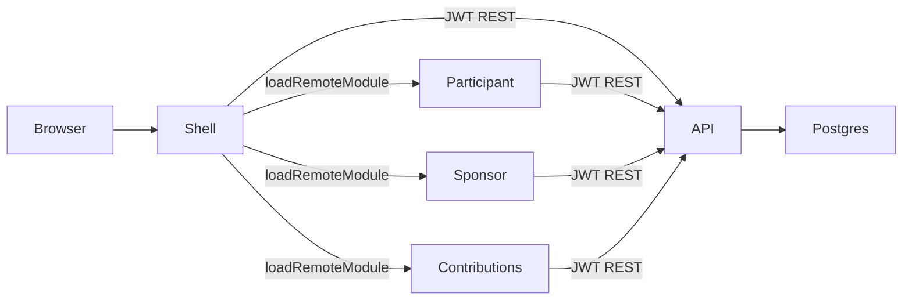

# Harborpath Recordkeeping

Interview demo: an Angular **Native Federation** micro-frontend and a **Spring Boot** recordkeeping API. It is a fictional TPA-style platform (401(k) + 529, participant and plan-sponsor chairs). It is **not** an official product of any company.

## Architecture



| Process | Port | Role |
|---|---|---|
| Shell host | 4200 | Login, chrome, loads remotes |
| Participant remote | 4201 | Household, deferral, beneficiaries |
| Sponsor remote | 4202 | Census, compliance queue |
| Contributions remote | 4203 | Shared ledger: payroll posting, 529 cash, activity tape |
| Spring Boot API | 8080 | `/api/v1` |
| Postgres | 5432 | System of record |

## Demo users

| Username | Password | Chair |
|---|---|---|
| `maya.chen` | `harborpath` | Participant |
| `jordan.ellis` | `harborpath` | Sponsor |

## Run with Docker

```bash
docker compose up --build
```

Open [http://localhost:4200](http://localhost:4200).

### Five-minute walkthrough

1. Sign in as **Maya Chen**. Note the 401(k) deferral at **7%** and the contribution tape.
2. Open the 401(k), change deferral to **8%**, save. The tape’s “next paycheck” line updates.
3. Open **Ledger**. Post a $250 529 contribution for Avery.
4. Sign out. Sign in as **Jordan Ellis**. Maya’s census row shows **8.00%**.
5. Open **Ledger** and **Post payroll** at $5,000 period pay. Maya’s employee line uses 8%.
6. Sign back in as Maya: household YTD employee is higher, and Ledger shows the payroll rows.
7. Acknowledge Priya Shah’s missing-beneficiary alert.

## Local development

Prerequisites: Node 22, JDK 21, Docker (for Postgres).

```bash
docker compose up postgres
cd backend
export JAVA_HOME="/opt/homebrew/opt/openjdk@21/libexec/openjdk.jdk/Contents/Home"
./mvnw test
./mvnw spring-boot:run
```

In three other terminals from the repo root:

```bash
npm install
npm start                  # shell :4200
npm run start:participant  # :4201
npm run start:sponsor      # :4202
npm run start:contributions  # :4203
```

The shell proxies `/api` to `localhost:8080`.

## Talking points

- **Native Federation vs one SPA** — participant, sponsor, and contributions are independently built remotes; the shell owns session and chrome. The ledger remote is shared by both chairs.
- **Remotes compose on data, not screens** — deferral lives in Household; payroll in Ledger reads that percent. Same API, separate deployables.
- **Role isolation at the API** — UI guards are convenience. A participant JWT cannot post payroll or read census; a sponsor JWT cannot patch Maya’s deferral.
- **One backend** — this is a bounded context, not a seven-service zoo. Recordkeeping (plan, account, census, alert) changes together.
- **What you’d add next** — SAML for plan sponsors, payroll contribution import, a real compliance engine instead of seeded alerts.

## Tests

```bash
cd backend && ./mvnw test
```

Uses Testcontainers Postgres. No H2.
